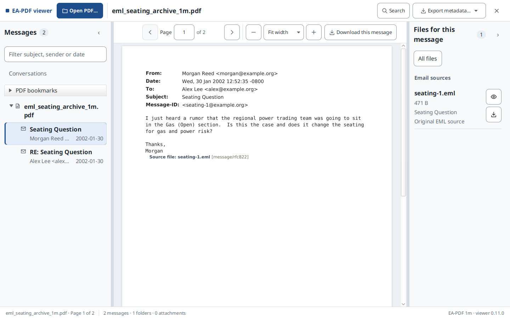

# EA-PDF Main

**Your email—complete, authentic, accessible, structured.**

EA-PDF is a specification for archiving email in PDF/A. It supports individual messages, combined archives and collections, with attachments, email metadata and optional original source messages.

Turn saved emails and mailboxes into PDFs you can read, search and archive. Supports EML, MSG, PST, MBOX and Gmail.

[User manual](docs/manual/user-manual.html) · [PDF manual](docs/EA-PDF_User_Manual.pdf) · [Release downloads](https://github.com/thinkbox-digital/eapdf/releases/tag/v2.4.0-beta.8)

## Download
| Item | Use it to |
| --- | --- |
| [Creator](https://github.com/thinkbox-digital/eapdf/releases/download/v2.4.0-beta.8/emailtopdfa-2.4.0-beta.8-gui.jar) | Convert email to PDF in a desktop window. |
| [Validator](https://github.com/thinkbox-digital/eapdf/releases/download/v2.4.0-beta.8/eapdf-validator-2.4.0-beta.8.jar) | Check a PDF and save a report. |
| [Desktop Viewer](https://github.com/thinkbox-digital/eapdf/releases/download/v2.4.0-beta.8/eapdf-desktop-viewer-full-0.9.1.jar) | Open PDFs, browse email and attachments, and save files. |
| Full browser readers for [Chromium](https://github.com/thinkbox-digital/eapdf/releases/download/v2.4.0-beta.8/eapdf-viewer-1.13.0-chromium.zip) and [Firefox](https://github.com/thinkbox-digital/eapdf/releases/download/v2.4.0-beta.8/eapdf-viewer-1.13.0-firefox.zip) | Read PDFs in your browser. |
| [Examples (ZIP)](https://thinkbox-digital.github.io/eapdf/ea-pdf-examples.zip) | Download sample EA-PDF messages, archives and collections. |

## Get started

Install a desktop version of Java 21 or later. Double-click the downloaded JAR to open the Creator, Desktop Viewer, and Validator. If an archive app opens, use **Open with** and choose Java.

Open the Creator, choose an email file or mailbox, and select where to save your PDFs.

To read a PDF, double-click the Desktop Viewer JAR, then choose **Open PDF…** or drag the PDF into the window. To check it, open the Validator and select the PDF.

## Choose an Output

| Format | Result |
| --- | --- |
| **1s** | One PDF per message, with its source and attachments. |
| **1m** | Two or more messages in one continuous PDF. |
| **1c** | A collection containing separately openable message PDFs. |
| **1si / 1mi / 1ci** | The same layouts with original sources and native attachment contents omitted. |

Visible text, addresses, metadata and inline images can remain in the isolated formats. Review the PDF before sharing it.
For PST, MBOX and Gmail, retained sources are exported messages. Keep the original mailbox separately.

All formats use PDF 2.0 / PDF/A-4f. See the [format guide](docs/manual/user-manual.html#basics).

## Project documentation

- Screenshots of the [Creator](docs/screenshots/creator-1280x800.png), [Validator](docs/screenshots/validator-1280x800.png), [Desktop Viewer](docs/screenshots/readme-viewer-1m.png), and [browser viewer](docs/screenshots/viewer-1280x800.png)
- [Software architecture diagram (PDF)](docs/EA-PDF_Software_Architecture.pdf)

Other editions are [Lite](https://github.com/thinkbox-digital/eapdf-lite), [Secure](https://github.com/thinkbox-digital/eapdf-secure). Developers can use the [technical guide](TECHNICAL_GUIDE.md).

[Apache License 2.0](LICENSE)
