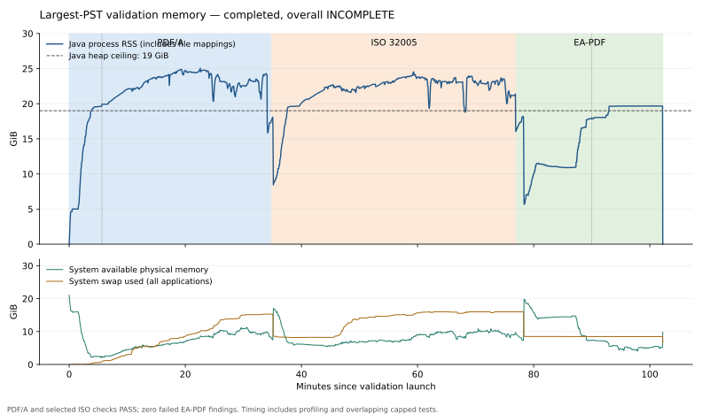

# Largest-PST validation memory retry — 2026-10-30

The retry completed on the existing 88,765-page PST 16 PDF. It used the frozen
bounded-cache validator `c1e35a85150fa72b89710590caf5f4bf1e277b96f46e280d2141edb69c31009d`.
The heap ceiling is 19 GiB, calculated from available physical memory at launch,
rounded down to 256 MiB after reserving 2 GiB. Four active processors bound JVM
parallelism. Other applications were not stopped. Swap is available but is not
counted as physical heap capacity. No conversion or source rewrite is performed.

Results: **PDF/A-4f PASS** (201,183,288 assertions), **selected ISO 32005 PASS**
(71,118,152 assertions across the pinned 1,636-rule profile), **9,951,528 passed
findings and zero failed findings** in the final EA-PDF report. The report also
contains 52,859 warnings and 40 N/A findings; warning counts are not damaged-email
counts. Overall **INCOMPLETE** and process exit **2** remain because four
unavailability findings record:

- Creator-recorded missing source information.
- An email without a unique supported-source binding.
- Nested email/mailbox candidates preventing a universal outer-header comparison.
- Some body content sets without an unambiguous original MIME media comparison.

PST/MBOX container omission is deliberate: derived RFC 822 messages are embedded.
Preservation checks cover those exports and recovered attachments, not complete
native containers. The provenance notice alone does not force INCOMPLETE. This
PDF additionally has recorded header-fidelity and source-comparison limitations,
including the two U+0016 Subject characters described in
[the follow-up investigation](FOLLOWUP.md). Container embedding is not an
outstanding repair in this work.

The run finished normally and did not exhaust memory. Source and PDF hashes match
before/after. The monitored retry took **6,156.96 seconds (102.6 minutes)** and
peaked at **25.04 GiB process RSS**, which includes mapped identity files beyond
the Java heap. System-wide swap peaked at about 16 GiB, including other apps.
Process RSS dropped to about 10.6 GiB between upstream passes and 5.7 GiB when
EA-PDF embedded-file checking began, confirming substantial release between
the existing passes. [Hash-matched completed-run evidence](largest-memory-retry.json).

Private evidence, commands, source/PDF/JAR hashes, per-second samples and the
standalone Java validation report are retained in
local verification records.
Scratch used disk under `.generator_web_tmp` and was removed after completion.
No OOM heap dump was needed. The complete standalone report is about 2.4 GiB.
IntelliJ’s available run configurations did not expose a validator entry point.
The standalone Java validator is runnable and completed this validation. Runtime
inspection used JFR, `jcmd`, GC logs and process mappings; this does not represent
an attached debugger session.

## Observed memory costs

1. **Eager veraPDF object loading.** The early thread snapshot reaches
   `COSDocument.getObjects` from `GFCosDocument` construction, before assertions
   execute. The pinned source calls `getObjects().size()` to obtain the indirect
   object count; enumeration parses and retains objects in the document body.
   Subsequent indirect-object traversal also needs these objects. Changing only
   the initial count would postpone this cost. A bounded approach needs to
   preserve enumeration, parser state and rule coverage across the whole pass.
2. **Dictionary and value representation.** The live histogram after its forced
   GC contains 113,890,625 veraPDF `COSObject` wrappers (2,733,375,000 shallow
   bytes) and 64,520,493 `HashMap.Node` entries (2,064,655,776 bytes). HashMap table
   arrays add 1,078,653,760 bytes. These are class totals, not a dominator analysis
   or an estimate of bytes removable by one change. Compact storage is a candidate
   for a separate equivalence-tested parser repair.
3. **Traversal paths and temporary lists.** The model/queue JFR snapshot attributes
   9.05% of sampled allocation pressure to `AbstractStringBuilder(String)` and
   11.68% to `ArrayList.grow`. These are cumulative allocation samples, not retained
   heap percentages. The live histogram includes 10,479,277 String objects and
   5,146,017 queued `GFCosIndirect` wrappers. Shared diagnostic path prefixes and
   eager model lists need further investigation before changing traversal order.
4. **Mapped identity storage.** The saved process mapping snapshot shows about
   3,636.5 MiB resident in the identity-key file and 512 MiB in its index, beyond
   roughly 20,009.7 MiB of anonymous mappings. File-backed pages are reclaimable;
   their RSS is not Java heap. `MappedFile` retains every mapped 16 MiB chunk until
   close. Bounded mapping windows are worth measuring, including random-lookup
   overhead and total physical memory, rather than interpreting lower RSS alone
   as a memory saving. Global swap usage includes other processes.
   The private identity records also store ASCII as UTF-16. A sample of the first
   100,000 stored IDs is entirely ASCII; alignment-aware compact storage reduces
   those record bytes by 25.3%. The candidate below implements this separately
   from any mapping-window change.
5. **Single-byte filter allocations.** Early JFR samples attribute 12–15% of
   allocation pressure to `ASInFilter.read`, whose pinned implementation creates
   a one-byte array per call. A reusable per-stream buffer is a possible targeted
   repair, subject to reentrancy/concurrency and decoding regressions.
6. **EA-PDF page-content retention.** Source inspection finds full extracted text
   for every page, marked-content sequences and several ownership indexes retained
   together. `LogicalStructureChecks` also remains live for later source checks.
   The live page-content histogram contains 1,944,873 logical entries (62,235,936
   shallow bytes), 4,867,813 property-list wrappers (77,885,008 bytes), 4,871,144
   soft references (194,845,760 bytes), 10,441,397 compact dictionaries and their
   pair stores (751,780,584 bytes), plus large map/array/string totals. Class
   totals do not attribute every reference to one owning cache. The thread
   snapshot reaches `DefaultResourceCache.removeProperties` through text-stripper
   page cleanup; the pinned source retains per-key removal history and can make
   frequently removed resources stable. The property-wrapper repair below bounds
   that cache without evicting canonical PDF objects.
   In particular, `childrenByParent` and the traversal `seen` set have no consumer
   after logical checking; later `sourceValues` uses entries and their ancestors.
   Releasing those indexes before page checking is a concrete follow-up candidate.
7. **Repeated XML field extraction during native attachment matching.** A later
   thread snapshot reaches `attachmentChecksum` and XML child-list construction
   inside each native file's candidate filter. Memoizing immutable parsed field
   values is a follow-up candidate for reducing temporary allocation and repeated
   work, while retaining candidate ordering, ambiguity and source-I/O behavior.

The live histogram forced a full GC (7.54 seconds) and a total heap-inspection
safepoint of 13.73 seconds. It reduced used heap from 15,853 to 12,931 MiB.
The page-content histogram forced a further 5.04-second GC and a 9.26-second
heap-inspection safepoint, reducing used heap from 14,303 to 8,871 MiB. Later
page-content checking completed in roughly 235 sampled seconds. Timing includes
these diagnostic disturbances and overlapping bounded test work; it is not an
isolated performance benchmark.

## Targeted changes prepared during the retry

`BaseValidator.addAllLinkedObjects` now builds a diagnostic path after confirming
that an object needs to be queued. Null-link diagnostics retain the same text;
the visited-ID check, queue order, rule evaluation and profiles are unchanged.
The completed largest retry used the original frozen JAR.

`SpillableIdSet` now stores ASCII identity characters as single bytes in its
private scratch format. A flag in the stored length selects this representation;
all other strings retain exact UTF-16 code units. Hash collisions, non-ASCII
characters, embedded NULs, supplementary characters and lone surrogates retain
exact membership and iteration behavior. Both byte and UTF-16 records are tested
across mapped-file boundaries; storage failure still propagates explicitly.

The real-run storage probe reads the same first one million IDs into both builds,
verifying exact membership and complete iteration. Logical key data falls from
31,600,008 to 23,600,008 bytes, a 25.3% reduction. All sampled IDs are ASCII. This
is not a whole-file or total-RAM reduction claim. The single probe's peak RSS is
396,398,592 versus 386,445,312 bytes; timings are 3.04 versus 2.60 seconds under
overlapping load. These are diagnostic observations, not a performance guarantee.

The candidate passes 198 validator tests (nine skips) and two executable-JAR
checks. All 22 retained real-email matrix outputs pass standalone Java EA-PDF and
PDF/A validation with identical per-code/per-level finding counts and PDF/A
assertion totals. Original source and PDF hashes are unchanged. No explicit
PDF/UA-2 rerun or largest-file saving is claimed for this candidate. Candidate
evidence is in local verification records;
the build log is retained with the large retry. The combined path/compact-store
candidate repeats all these checks and three focused identity tests after the
extra collision cases were added. Its frozen SHA-256 is
`d56757391e755bda27293a64fd38ce2bc306dd24762ec18839bfca23789c1998`.
[Candidate acceptance evidence](memory-candidate-acceptance.json) links the hashes,
counts and real-identity probe results. Its private evidence is retained under
local verification records.
These intermediate candidates did not replace the installed validator or the
largest retry's JAR.

`ValidationResourceCache` additionally bounds property-list wrappers to 2,048
entries and handles their removals without retaining PDFBox's per-key removal
history. Font and other resource caches retain the PDFBox default policies.
Eviction reconstructs wrappers over the same canonical COS dictionaries; PDF
objects, graph ownership, fields and checks remain available. A focused regression
forces eviction and removal through real `PDResources` lookups, then verifies
canonical dictionary identity and values on reload.

The final combined candidate passes **199 validator tests** (nine skips), **two
packaging checks** and **all 22 retained real-email matrix PDFs**, with unchanged
per-code/per-level outcomes, PDF/A assertion totals and source/PDF hashes. Its
SHA-256 is `fbd8f93aa88fa80e2d4ced63466c3b897ca2c9db5c4e5bd98a670ab4ed7902a5`.
[Final candidate evidence](memory-resource-cache-acceptance.json) identifies source
hashes and retained logs/reports. Its private artifacts are in
local verification records.
Its own largest-file run now completes with identical per-code/per-level finding
counts and both upstream assertion totals: 5,395.27 seconds and 23.16 GiB peak
RSS. Source/PDF hashes match and scratch is removed. These are non-isolated local
measurements. [Completed candidate comparison](initial-candidate-largest.json).
The installed JAR remains unchanged. [Further memory repairs](FOLLOWUP.md).
