# Architecture and execution

## System boundaries

The generator is a Java 21 application. The validator is a separate Python application with pikepdf/qpdf and pypdf inspection, plus an independent veraPDF process. The Flask application uploads local files, launches the packaged Java generator and Python validator, then renders HTML results. The Swing GUI launches Java subprocesses. There is no shared database or stable normalized message API.

```mermaid
flowchart LR
    Local[EML / MSG / PST / MBOX] --> Readers[Source readers]
    Gmail[Gmail API + OAuth] --> Readers
    Readers --> Model[EmailRecord + AssociatedFile]
    Model --> Stage[JobReport / PayloadStore]
    Stage --> HTML[HTML + CSS + CID + fonts]
    HTML --> Render[OpenHTMLtoPDF]
    Render --> PDF[PDFBox assembly]
    Model --> PDF
    PDF --> Gate[Staged creator consistency checks]
    Gate --> Save[Atomic PDF replacement + sidecars]
    Save --> Validate[Python EA-PDF checks]
    Save --> Vera[veraPDF PDF/A checks]
    Validate --> Report[JSON / HTML / CLI result]
    Vera --> Report
```



Native email content and PDFs are untrusted parser inputs. OAuth credentials/tokens, original messages, staging data, generated PDFs and reports are private data. The renderer's allowed resource registry is a deliberate trust boundary; email-provided filesystem URLs do not get general filesystem access.

## Complete production module map

All Java paths below are relative to `src/main/java/eapdf/`.

| File | Responsibilities / rewrite boundary |
| --- | --- |
| `EmailToPDFA.java` | CLI parsing, recursive input discovery, MSG signature sniffing, jobs, per-message/archive dispatch, output names |
| `GmailDownloadToPdf.java` | Read-only OAuth, label resolution, message listing/raw download, bounded retries, resume orchestration, output dispatch |
| `GmailResumeStore.java` | Account/options-scoped manifests, private disk cache, file lock, checksum-based download/output reuse |
| `MonthlyFilenameArchiveToPdf.java` | YYYYMMDD filename grouping, chronological records, `s` for one / `m` for multiple messages |
| `EapdfGui.java` | Swing local/Gmail forms, temporary effective config, subprocess output and forcible Stop |
| `EmlReader.java` | RFC message parsing, lenient addresses, MIME body selection, native/inline/attached-message collection |
| `MsgReader.java` | Outlook parser mapping, original OLE preservation, CID files, embedded-message standalone MSG extraction |
| `PstReader.java` | Recursive folder/message traversal, MAPI/header recovery, RTF conversion, supported attachment methods, EML reconstruction |
| `MboxParser.java` | Byte-preserving line splitting, envelope detection, Content-Length variants, one-level quoting reversal |
| `MboxReader.java` | Parser callbacks, EML source names, Gmail label fallback, staging |
| `Models.java` | Mutable email/agent/associated-file/body-selection data classes |
| `Common.java` | Job/log contexts, metadata normalization, hash/date/address/MIME/name utilities, EML synthesis, assets and atomic publication |
| `ProcessingLimits.java` | Environment/property limits and estimated byte/count accounting |
| `PayloadStore.java` | Job-owned private temporary body/attachment files and cleanup |
| `EapdfConfig.java` | Cached typed configuration, validation, defaults and normalization |
| `EmailStyles.java` | Parse source stylesheets, print-media rules, selector scoping and reduced-CSS warnings |
| `FontSupport.java` | Explicit fallback fonts, glyph coverage, embedded UI fonts, warning-producing substitution |
| `PdfMailWriter.java` | Renderer adapter, all profile orchestration, source embedding, XMP, native attachment notices, metadata, outlines, visual helpers |
| `PdfDocumentParts.java` | Indirect object allocation, DPartRoot/tree and page ranges/backreferences |
| `SemanticStructure.java` | Header tags, renderer tree import, standard namespaces, MCID/MCR/OBJR/ParentTree correspondence and destinations |
| `PdfCollectionSupport.java` | Folder membership/order, collection members, schema, folder dictionaries, collection item metadata and saved-file repair |
| `PdfFindingAidSupport.java` | Landscape PDF index, spreadsheet, source badge rewrites, archive links and PREMIS sidecar publication |
| `PremisBuilder.java` | Optional XML objects/events/agents and collection-child links; R5 requires schema repair |
| `PdfCreationValidator.java` | Selected pre-publication consistency assertions; not full independent validation |

Other executable/configuration surfaces:

| Path | Responsibility |
| --- | --- |
| `validate_eapdf.py` | Rule registry, PDF/XMP inspection, source comparisons, child validation, independent PDF/A adapter, report/CLI |
| `validator_web.py` | Flask routes, disk registries/locks, upload staging, subprocess budgets, report rendering and expiry |
| `validator_rule_text.json` | Local rule descriptions/spec explanations; not an independent conformance specification |
| `scripts/regenerate_email_samples.py` | Create/check six samples before individually replacing saved examples |
| `scripts/generate_decision_tree.py` | ReportLab workflow diagram generation; unrelated to PDF writer implementation |
| `pom.xml` | Java dependencies, resources, tests and CLI/GUI Shade artifacts |
| `src/main/resources/eapdf-build.properties` | Packaged version, filtered by Maven |
| `config/eapdf_config.json` | Runtime application feature settings |
| `config/ea-pdf-linux.json`, `config/ea-pdf-fop.xconf` | Legacy/external FOP/XSLT workflow configuration; not used by this renderer |
| `deploy/*` | nginx reverse proxy, Gunicorn service, cleanup service/timer |

No active Facebook/Twitter source readers exist in the reviewed tree; their historical data directories do not establish supported workflows. Existing deleted files were not restored.

## Dependency capabilities to replace

Exact direct versions belong to the reviewed `pom.xml`, not historical prose. A port needs equivalents for MIME/mail date/address handling (Jakarta Mail/Angus), MSG/OLE (Outlook parser + POI), PST (java-libpst), DOM/CSS normalization (Jsoup/OpenHTMLtoPDF), HTML print layout, a low-level PDF 2.0 writer with embedded fonts/streams and custom dictionaries (PDFBox), font coverage, Excel export (POI), JSON, OAuth/Gmail and HTTP. The Java writer builds XMP XML manually despite declaring XMPBox.

Do not choose a PDF library solely because it can “save PDF/A.” It must preserve indirect relationships while importing pages, support DPM, collection folders/items, namespace-aware tagging/ParentTree, binary MD5 parameters, UTF-8 XMP and file-attachment appearance streams. Validate these capabilities in a prototype before porting readers. Libraries without such APIs need a reviewed low-level object adapter.

## Single-message sequence

```text
begin job
parse and validate switches; resolve config/font/ICC
discover input; read and normalize; assign a synthetic GUID
stage payloads if the caller uses a JobReport-backed reader
derive destination and requested profile
require a verifiable sent date
build scoped XHTML and trusted CID assets
render XHTML; on failure retry reduced plain text with warning
load rendering into PDFBox; set PDF 2.0
add native/omitted attachment notice pages and visual context
configure catalog, outlines, DPM, source/finding-aid attachments
rewrite source badge links into file-attachment annotations
construct logical structure and XMP; add sRGB output intent
normalize page streams
save temporary PDF; run creator consistency gate
flush file; replace destination
write enabled sidecars; record warnings; clean job-owned files
```

`buildSingleMessagePdf` can also return bytes for a collection caller. Its in-memory gate runs before saving; file-backed publication reopens the staged file through the atomic helper. The public CLI does not run the Python/veraPDF acceptance workflow automatically.

## Multi-message and collection sequences

For `m/mi`, finalize distinct record GUIDs and profile policy. Build optional finding-aid front matter. Render messages with a bounded number of in-flight jobs, consuming results in input order. Clone message pages and semantic trees into a disk-cache-backed PDF. Record one inclusive page segment per message, configure outlines/DPM, attach sources/auxiliary files, connect finding-aid links, rebuild structure and write aggregate XMP. Validate the staged result before replacing the PDF. Write optional sidecars afterwards.

For `c/ci`, derive folder memberships and case-insensitive group sections. Create one `s/si` child per message per included folder, staging child PDFs on disk. Build required front matter even when the optional index is disabled. Embed children with Collection Items, plus sources when enabled; add auxiliary files; generate front-matter-only DPM/structure. Save, repair/rewrite the collection schema/items using the existing saved-file pass, validate and replace. A multi-label message can have multiple rendered child instances; its underlying record GUID remains the same. Top-level XMP currently includes message records even though no top-level DPM message nodes exist.

Archive output order generally follows reader/input order. Collections group alphabetically and currently build messages **in reverse chronological order** inside each folder; some older generated text says chronological. The monthly utility explicitly sorts ascending. Specify the intended order for a replacement instead of copying conflicting UI descriptions.

## Ownership and concurrency

`JobReport` is inherited through thread-local state and owns one `PayloadStore`. Staging is synchronized, counts records/estimated metadata, clears large in-memory payloads and deletes temporary files at job close. PDF documents and streams are closed through scoped ownership. Archive render jobs are bounded and consumed in order. Local `--jobs` is also limited by CPU, heap and work-item counts. Shared font/asset caches and the remote-blocklist live for the JVM lifetime.

The replacement should use explicit immutable job/configuration contexts and payload ownership instead of JVM-wide mutable configuration and inherited thread locals. Release payloads only after every renderer, PDF embedder, hash reader and checkpoint user is finished. Process-level deadlines are needed because cancellation does not guarantee third-party parser threads terminate.
