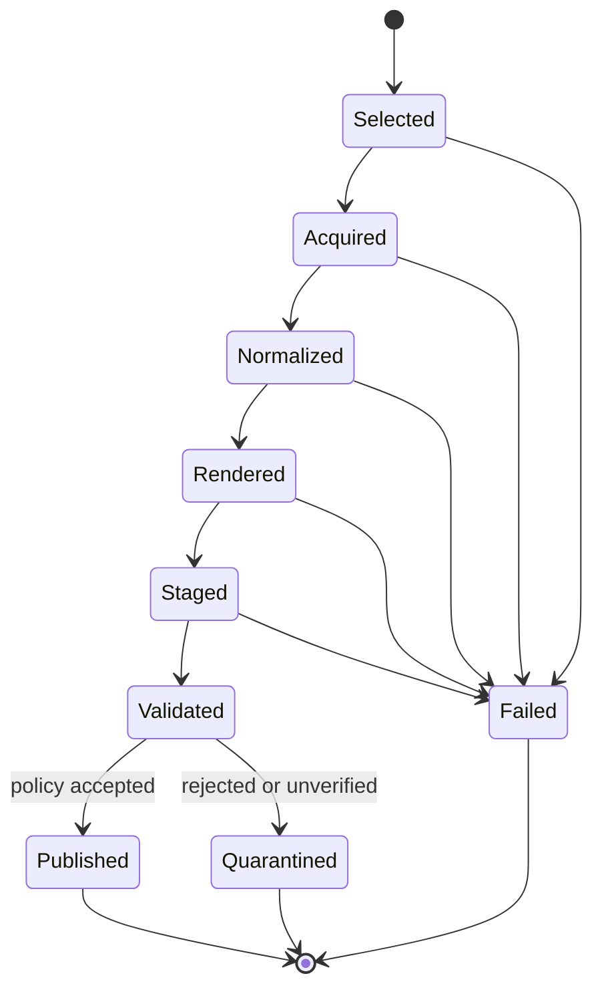

# Language-independent replacement plan

## Compatibility versus corrected behavior

Retain documented inputs, profiles, CLI spelling, archive-owner semantics and intentional overwrite behavior unless explicitly changed. Preserve source/native bytes, truthful metadata, profile cardinality and navigation semantics. Do not preserve R1–R8 as compatibility requirements. PDF object numbers, compression, GUID values, typography and raw PDF byte order are not compatibility targets.

The proposed normalized JSON schema is a **new internal boundary**, not an undocumented existing API. It is deliberately stricter about original/stored payload identity than `Models.java`. A job manifest may reference normalized messages without loading all bytes. Export it for debugging or language migration only with explicit private-data handling.

## Component contracts

The following signatures are pseudocode. Streams/iterators must be closeable; error values are typed and carry source IDs.

```text
SourceAdapter.scan(input, policy, budget, cancellation) -> iterator<SourceItem>
SourceAdapter.read(item, payloadStore, budget) -> NormalizedMessage
PayloadStore.put(stream, budget) -> PayloadRef
PayloadStore.open(ref) -> byteStream
PayloadStore.release(ref)

Normalizer.normalize(message, policy) -> message + diagnostics
PreservationPlanner.plan(message, profile, policy) -> PreservationPlan
Renderer.render(message, renderContext, budget) -> RenderedMessage
PdfAssembler.single(rendered, plan, documentMetadata) -> StagedPdf
PdfAssembler.archive(orderedRendered, frontMatter, plans) -> StagedPdf
PdfAssembler.collection(orderedMembers, folderPlan, frontMatter) -> StagedPdf
MetadataWriter.write(document, messageGraph, preservationPlan)
StructureWriter.write(document, contentSets, semanticAnchors)

AcceptanceValidator.inspect(staged, requirements, externalValidators) -> AcceptanceReport
ArtifactPublisher.publish(acceptedArtifacts, manifest, overwritePolicy) -> PublicationResult
ResumeStore.load(scope) -> Checkpoint
ResumeStore.saveAtomically(checkpoint)
```

| Value | Essential fields / invariant |
| --- | --- |
| `JobContext` | Unique ID, immutable effective config, profile, source selection, fonts/ICC/tool hashes, owner, budgets, cancel token |
| `PayloadRef` | Length, MD5, SHA-256, stream locator, ownership/lifetime; path confined to the store |
| `NormalizedMessage` | GUID, original identity/headers/date, display values, selected source body/type, source provenance, memberships, native/inline files |
| `PreservationPlan` | Original asset mapping, stored/native/omitted representations, safe PDF names, relationships, expected metadata and policy reasons |
| `RenderedMessage` | Pages/streams, image/link/text evidence, source-body selection, semantic anchors, explicit reduced-rendering findings |
| `ContentSet` | Kind, source type/parameters, owning GUID, inclusive page range, description, first-page outline target |
| `CollectionMember` | Child profile/hash/payload, folder membership, order, subject/sent/core fields, source identity |
| `Finding` | Requirement ID, strength, applicability, PASS/FAIL/UNVERIFIED/N/A, observed/expected values, evidence, source/page/object location |
| `ArtifactManifest` | All source/output hashes, parent-child links, validation/fidelity decisions, publication status, timestamps and versions |

Require the metadata writer, annotation writer and gate to consume the same immutable preservation plan. That prevents sizes/checksums from describing original bytes while the PDF stores an omitted or transformed representation.

## Error and acceptance model

Use distinct error categories for invalid arguments/config, unsupported input, parse failure, missing required metadata, resource budget, reduced rendering, validator unavailable/failure, cancellation, publication failure and partial job completion. Preserve human/debug text at the compatibility boundary, but expose machine-readable diagnostics internally.

Recommended job state transitions:



Cancellation and process death need persisted checkpoints and cleanup ownership. A validated PDF can still require human fidelity review. Publish final acceptance in a manifest after all required artifacts exist; record partial completion when independent per-message outputs were already published.

## Decisions to settle before implementation

| Decision | Existing behavior | Replacement requirement / decision needed |
| --- | --- | --- |
| Conformance target | PDF 2.0 / PDF/A-4f; six EA-PDF profiles | Pin standards editions/errata; separately scope PDF/A-3 if required |
| Raw mailbox preservation | Exported/reconstructed EML | Decide whether original PST/MBOX must be retained/embedded and how derivation is mapped |
| Isolation | Drops sources/native bytes, keeps renders/allowed aids | Explicit policy, original/stored metadata and loss warnings |
| Renderer | Offline print HTML subset | Choose fidelity baseline and unsupported-content behavior; prove image-only/layout/Unicode handling |
| Tagging/accessibility | Tags always present; richer optional features; no PDF/UA ID | Complete TS 32005 strategy; PDF/UA claim only after its separate acceptance |
| Missing sent date | Reject output | Keep rejection or define verifiable curator-supplied evidence without inventing dates |
| Ordering/folders | Input order for archives; grouped reverse-time collection children | Choose/preserve explicit order and label-vs-folder semantics; resolve conflicting prose |
| Asset names | Multiple sanitizers, case-sensitive file keys | One policy per PDF/collection/disk context, deterministic mapping after normalization |
| Validation | Java gate + Python/veraPDF separate | Independent acceptance boundary with no mandatory-rule warning passes |
| Config | Process singleton, missing paths default | Per-job immutable config; capture effective settings, fail explicit missing path |
| Privacy/deployment | Capability URLs, external proxy assumptions | Authenticated ownership, retention and worker isolation appropriate to chosen deployment |
| Distribution | Shaded JAR, incomplete notices | Language-appropriate packaging, full dependencies/assets/rights and reproducible release |

## Implementation order

1. Freeze a source snapshot, standards register, private fixture corpus and evidence formats. Record unresolved interpretations before coding.
2. Prototype the PDF library boundary: one valid PDF/A-4f message with embedded original, native annotation, XMP, DPM, outlines and namespace-aware structure. Validate with independent tools. Reject an unsuitable PDF library early.
3. Implement payload storage, budgets, typed diagnostics and normalized model. Add exact raw/native hash round-trip fixtures.
4. Implement EML/MIME reader and rendering with A01–A18, specifically R1/R4/R7. Preserve source-field provenance and selected MIME parameters.
5. Implement strict serialization/preservation plans and validate every relation with positive/negative mutations. Close R2/R3/R6.
6. Add m/mi, finding aids and c/ci with recursive independent validation and normalized naming. Confirm memory/temp-disk behavior on long archives.
7. Add MSG/PST/MBOX with independent source-parser verification and the approved mailbox preservation boundary. Add Gmail with a test service, then consented live account tests.
8. Add valid PREMIS 3 and optional XLSX; verify schemas and event semantics. Keep ancillary features from weakening PDF/email checks.
9. Port CLI/GUI/web interfaces around the tested core; add process isolation, ownership, cancellation, retention, operational monitoring and release packaging.
10. Run the complete clause register/corpus/mutation/load/recovery/viewer/accessibility acceptance. Retain signed-off evidence and identify every residual unsupported case.

## Handover package

Provide the replacement team these documents and schema/examples, the complete reviewed source tree (including currently untracked classes/tests), exact POM/resolved dependency graph and Python lock, fonts/ICC/branding with applicable rights/notices, normative standards and errata, test fixture provenance, generated accepted/rejected PDFs, extracted source/native files and hashes, independent validation reports, executable reproduction commands, configurations, threat/deployment assumptions and release sign-off criteria.

The documentation cannot substitute for the standards, a PDF/MIME implementation or further acceptance engineering. It supplies a concrete rewrite reference and explicitly identifies where copying the current Java/Python behavior would copy a defect.
